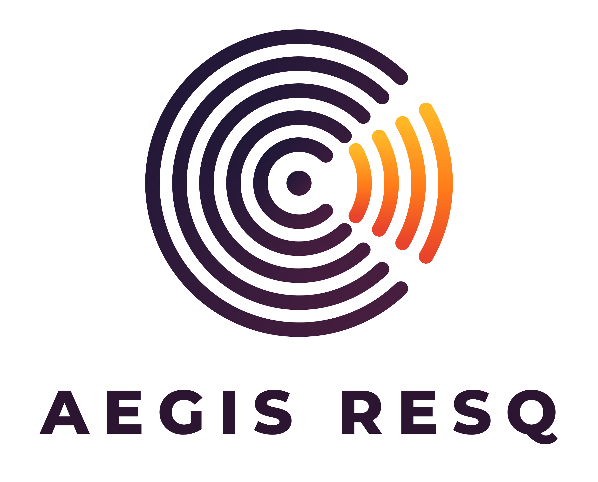

<p align="center">
  
</p>

# Aegis ResQ

Aplicación Android de código abierto (Ionic + Angular + Capacitor) para **experimentar** con una red
colaborativa de teléfonos que apoye la búsqueda de personas durante terremotos, inundaciones y otros
desastres, **sin depender de Internet ni de la red celular**.

Los teléfonos se descubren entre sí por **Bluetooth Low Energy** e intercambian mensajes cortos
**codificados en sonido** (altavoz → micrófono), que pueden saltar de un teléfono a otro.

> ⚠️ **Prototipo académico.** No es un sistema de rescate certificado, no sustituye a los organismos
> de emergencia y **no garantiza** encontrar personas atrapadas. Cada función debe validarse con
> dispositivos físicos en escenarios controlados.

---

## Contenido

1. [Objetivo académico](#1-objetivo-académico)
2. [Créditos](#2-créditos)
3. [Funcionalidades implementadas](#3-funcionalidades-implementadas)
4. [Funcionalidades experimentales y no implementadas](#4-funcionalidades-experimentales-y-no-implementadas)
5. [Arquitectura y tecnologías](#5-arquitectura-y-tecnologías)
6. [Protocolo acústico](#6-protocolo-acústico)
7. [Requisitos previos](#7-requisitos-previos)
8. [Instalación y ejecución en desarrollo](#8-instalación-y-ejecución-en-desarrollo)
9. [Compilación de Android y ubicación del APK](#9-compilación-de-android-y-ubicación-del-apk)
10. [Ejecución en emulador](#10-ejecución-en-emulador)
11. [Pruebas realizadas](#11-pruebas-realizadas)
12. [Permisos de Android](#12-permisos-de-android)
13. [Micrófono y protección de datos](#13-micrófono-y-protección-de-datos)
14. [Configuración de participantes](#14-configuración-de-participantes)
15. [Limitaciones de Bluetooth y del audio](#15-limitaciones-de-bluetooth-y-del-audio)
16. [Funcionamiento sin Internet](#16-funcionamiento-sin-internet)
17. [Guía de validación en dispositivos físicos](#17-guía-de-validación-en-dispositivos-físicos)
18. [Preparar una versión de distribución](#18-preparar-una-versión-de-distribución)

---

## 1. Objetivo académico

Proyecto inscrito en la **XII Feria de Emprendimiento, Creatividad e Innovación** (ID PRJ-3914,
ámbito ambiental, tecnológico y social). La ficha original propone convertir los micrófonos y
parlantes de cualquier celular en nodos de una red de malla que:

- transmita datos de emergencia con **tonos de alta frecuencia** casi inaudibles;
- **repita los mensajes de vecino en vecino** hasta salir de la zona del desastre;
- funcione con **3 a 5 celulares de cualquier marca**, incluso en modo avión y sin SIM;
- reutilice teléfonos guardados, sin hardware nuevo.

Esta aplicación implementa la parte de esa propuesta que se puede construir y verificar con
honestidad (ver secciones 3 y 4).

## 2. Créditos

**Institución:** Gimnasio Bilingüe Altamar de Cartagena · Grado 9A
**Docente acompañante:** Ricardo Herrera

**Integrantes:**

| Avatar | Integrante |
| --- | --- |
|  | Maria Camila Arroyo Mezamell |
|  | Anahi Sofia Mendoza Tous |
|  | Gabriela Merlano Espejo |
|  | Salomon Vergara Canoa |
|  | Ricardo Herrera (docente) |

Logotipo: proporcionado por el equipo. Avatares: ilustraciones originales generadas por código
(`scripts/generate-graphics.mjs`). Los créditos se editan en `src/assets/config/participants.json`.

## 3. Funcionalidades implementadas

| Función | Estado | Detalle |
| --- | --- | --- |
| Inicio sin usuario ni contraseña | ✅ | Abre directamente en el panel de inicio. |
| Menú lateral con 9 secciones | ✅ | Inicio, Red, Audio, Detección, Ubicación, Participantes, Permisos, Diagnóstico, Acerca de. |
| Descubrimiento BLE real | ✅ | Escaneo de anuncios Aegis ResQ + anuncio propio (plugin nativo `AegisNative`). |
| Lista de nodos sin duplicados | ✅ | Indexada por id de sesión; estados *disponible / enlace verificado / fuera de alcance*. |
| Métricas de enlace reales | ✅ | RSSI medio y variación, anuncios/s, entregas confirmadas, latencia ACK. |
| Nodo recomendado con razones | ✅ | Solo sugerencia; la selección es siempre manual. |
| Módem acústico (MFSK) | ✅ | Emisión y recepción por Web Audio; perfiles audible y casi ultrasónico. |
| Malla con reenvío | ✅ | TTL (3 saltos), descarte de duplicados, límite de frecuencia, reenvío opcional. |
| Sesión dirigida (A) | ✅ | Mensaje a un nodo con confirmación y hasta 2 reintentos. |
| Difusión (B) | ✅ | Una emisión para todos; cada participante confirma por separado. |
| Señal de prueba acústica | ✅ | Trama conocida con CRC para medir alcance entre teléfonos. |
| Ubicación bajo demanda | ✅ | GPS del teléfono con precisión, hora, fuente y validez; compartible con confirmación. |
| Modo demostración | ✅ | Nodos simulados rotulados «SIMULADO» y franja amarilla permanente. |
| Permisos y privacidad | ✅ | Estado real de cada permiso, solicitud y acceso a ajustes del sistema. |
| Diagnóstico técnico | ✅ | Complementos, capacidades de audio/BLE, autoprueba del módem y registro de eventos. |
| Participantes desde JSON | ✅ | Con validación y estado de error comprensible. |

## 4. Funcionalidades experimentales y no implementadas

- **Detector de golpes repetidos — experimental.** Busca ≥ 3 impulsos con intervalos regulares.
  No está validado, no informa confianza y cada evento debe confirmarlo o descartarlo una persona.
- **Voz y gritos:** no se clasifican automáticamente.
- **Voz en vivo entre teléfonos — no implementada.** El canal acústico transmite ~44 bit/s; la voz
  requeriría un enlace de mayor capacidad (p. ej. Wi‑Fi Direct).
- **Triangulación / tiempo de vuelo — no implementada.** La ficha propone calcular «los metros exactos»
  con el retraso del sonido. Eso exige relojes sincronizados al milisegundo, posiciones conocidas de
  los micrófonos y calibración de la latencia de audio de cada modelo de teléfono, que no están
  disponibles ni validados. La app **no genera coordenadas estimadas**.
- **Distancia por Bluetooth:** el RSSI se muestra como intensidad (fuerte/media/débil), nunca como metros.
- **Funcionamiento en segundo plano:** no hay servicio en primer plano; la red funciona con la app abierta.
- **Sincronización por Internet:** no existe; la app no contacta servidores.

## 5. Arquitectura y tecnologías

| Componente | Versión |
| --- | --- |
| Angular | 22.1.7 (componentes *standalone*, señales, sin zone.js) |
| Ionic | 9.0.8 |
| Capacitor | 8.5.2 (Android, `minSdk 24`, `targetSdk 36`) |
| @capacitor-community/bluetooth-le | 8.3.0 |
| TypeScript / Vitest | 6.0.3 / 4.0.18 |
| Android Gradle Plugin / Gradle | 8.13.0 / 8.14.3 |

```
src/app/
├── core/                      Servicios transversales
│   ├── errors/app-error.ts    Códigos de error → mensajes de usuario + detalle técnico
│   ├── native/aegis-native.ts Interfaz TS del plugin nativo (anuncio BLE, permisos, ajustes)
│   ├── demo/                  Simulador de nodos (solo modo demostración)
│   └── services/              Permisos, conectividad, ajustes, identidad de sesión, registro
├── features/
│   ├── dashboard/             Pantalla de inicio
│   ├── devices/               Baliza BLE, registro de nodos, puntuación, descubrimiento
│   ├── rescue/
│   │   ├── acoustic/          Goertzel, códec MFSK, servicio de audio (Web Audio + AudioWorklet)
│   │   ├── mesh/              Tramas con CRC, router de malla, servicio de malla (ACK, reintentos)
│   │   └── detection/         Detector experimental de golpes y eventos de detección
│   ├── location/              Ubicación bajo demanda
│   ├── participants/          Carga y validación de participants.json
│   ├── settings/              Permisos, privacidad, configuración y diagnóstico
│   └── about/
└── shared/                    Componentes visuales, modelos y utilidades
android/app/src/main/java/org/aegisresq/app/AegisNativePlugin.java   Plugin nativo propio
```

La lógica sin E/S (códec, tramas, router, registro y puntuación de nodos, detector) está separada de
los servicios que tocan hardware, y por eso se prueba sin dispositivo.

**Tecnología de transporte elegida:**

| Opción | Evaluación |
| --- | --- |
| BLE (anuncios) | ✅ Descubrimiento y señalización: id de sesión y banderas en 7 bytes. No transporta audio. |
| Audio (altavoz/micrófono) | ✅ Transporte de mensajes: funciona en cualquier teléfono, en modo avión, y es el núcleo de la ficha. Baja capacidad. |
| Wi‑Fi Direct | ❌ No implementado: requiere plugin nativo propio y emparejamiento; candidato para voz en el futuro. |
| Wi‑Fi local | ❌ Requiere un punto de acceso común, que puede no existir en un desastre. |

## 6. Protocolo acústico

- **Modulación:** MFSK diferencial de 17 tonos; cada símbolo transporta 4 bits y nunca repite el
  tono anterior, así que el receptor no necesita reloj común. Detección con el algoritmo de Goertzel.
- **Perfiles:** audible 1,5–3,5 kHz (recomendado para pruebas) y casi ultrasónico 17–19 kHz (según
  la ficha; depende del altavoz y del micrófono). Símbolos de 90 ms → ~44 bit/s.
- **Trama:** versión/tipo · id de mensaje · TTL · origen · destino · longitud · carga (≤ 32 B) · CRC‑8.
- **Tipos:** texto, confirmación (ACK), señal de prueba, ubicación.
- **Malla:** inundación controlada con TTL 3, caché de mensajes vistos (5 min), límite de 20 tramas
  por minuto y origen, retardo aleatorio antes de reenviar o confirmar para reducir colisiones.

## 7. Requisitos previos

- Node.js 24 (probado con 24.19.0) y npm 11.
- Android Studio con Android SDK 36 o superior.
- **JDK 21 para Gradle.** Gradle 8.14.3 no se ejecuta con JDK 25 (el que trae ahora Android Studio:
  «Unsupported class file major version 69»). Se usó el JBR 21 que instala Android Studio en
  `%USERPROFILE%\.jdks\jbr-21.*`.

## 8. Instalación y ejecución en desarrollo

```bash
npm install
npm start            # ng serve → http://localhost:4200 (BLE y permisos nativos no disponibles en web)
npm test             # verifica avatares/JSON y ejecuta las pruebas unitarias (Vitest)
npm run lint
```

Para regenerar avatares, iconos Android y splash a partir del logotipo de `resources/brand/`:

```bash
node scripts/generate-graphics.mjs
```

## 9. Compilación de Android y ubicación del APK

```bash
npm run build
npx cap sync android
cd android
# Git Bash:
export JAVA_HOME="$USERPROFILE/.jdks/jbr-21.0.11"
./gradlew assembleDebug
```

En Windows con `cmd` también puede usarse `npm run android:apk`, siempre que `JAVA_HOME` apunte a un JDK 21.

Si Gradle no encuentra el SDK, crea `android/local.properties` con
`sdk.dir=C\:\\Users\\<usuario>\\AppData\\Local\\Android\\Sdk` (no se versiona).

**APK de depuración generado:**

- Relativa: `apk/AegisResQ-0.1.0-debug.apk` (copia versionada)
- Salida de Gradle: `android/app/build/outputs/apk/debug/app-debug.apk`

Es un build *debug* firmado con la clave de desarrollo: se instala en cualquier Android 7+ activando
«Instalar apps desconocidas», pero no sirve para Play Store.

## 10. Ejecución en emulador

```bash
emulator -list-avds
emulator -avd <nombre>
adb install -r apk/AegisResQ-0.1.0-debug.apk
adb shell am start -n org.aegisresq.app/.MainActivity
```

En el emulador `Testing` (Android 17, API 37) se verificó que la app abre, que el menú y todas las
pantallas funcionan, que los cinco participantes cargan con sus avatares y que todos los complementos
están disponibles. La autoprueba del módem pasa, y al conceder los permisos el descubrimiento BLE se
inicia con Bluetooth activado. El emulador **no** permite validar la transmisión por aire ni ver a
otros teléfonos reales: eso requiere dispositivos físicos (sección 17).

## 11. Pruebas realizadas

`npm test` ejecuta **53 pruebas en 12 archivos, todas superadas**, además de `scripts/verify-assets.mjs`:

| Requisito verificado | Prueba |
| --- | --- |
| Inicia sin autenticación | `app.component.spec.ts` |
| El menú lateral tiene las 9 secciones y cada ruta carga su pantalla | `app.component.spec.ts` |
| Los 5 participantes se cargan del JSON; errores de configuración no bloquean | `participants.service.spec.ts` |
| Los avatares existen en las rutas declaradas y son PNG válidos | `scripts/verify-assets.mjs` |
| Distinción entre modo real y demostración | `page-header.component.spec.ts`, `discovery.service.spec.ts` |
| Permisos denegados: no se abre el micrófono ni se obtiene ubicación | `permission-gating.spec.ts` |
| El descubrimiento inicia y se detiene; Bluetooth desactivado se informa | `discovery.service.spec.ts` |
| Nodos duplicados no se cuentan dos veces; pérdida de nodos reflejada | `discovery.service.spec.ts`, `node-registry.spec.ts` |
| No se generan detecciones ni tramas falsas a partir de ruido | `fsk-codec.spec.ts`, `knock-detector.spec.ts`, `permission-gating.spec.ts` |
| Códec acústico con ruido, desalineación y bloques irregulares | `fsk-codec.spec.ts` |
| Tramas: CRC, límites de tamaño y mensajes malformados | `frame.spec.ts`, `beacon.spec.ts` |
| Malla: duplicados, TTL, reenvío opcional, límite de frecuencia | `mesh-router.spec.ts` |
| Sesión dirigida confirmada por ACK acústico; detener cancela | `mesh.service.spec.ts` |

Pruebas manuales en el emulador: ver sección 10. La app abre sin Internet porque todo el contenido va
dentro del APK y no se declara el permiso `INTERNET`.

**No realizadas (requieren hardware):** transmisión acústica entre teléfonos, descubrimiento entre
dos teléfonos físicos, anuncio BLE visto por otro dispositivo, alcance a través de paredes o escombros.

## 12. Permisos de Android

| Permiso | Para qué | Cuándo se pide |
| --- | --- | --- |
| `BLUETOOTH_SCAN`, `BLUETOOTH_CONNECT` (12+) | Escanear anuncios de otros nodos | Al iniciar el descubrimiento |
| `BLUETOOTH_ADVERTISE` (12+) | Que otros nodos detecten este | Al iniciar el descubrimiento |
| `BLUETOOTH`, `BLUETOOTH_ADMIN` (≤ 11) | Equivalente en versiones antiguas | Concedidos al instalar |
| `ACCESS_FINE/COARSE_LOCATION` | Android lo exige para entregar resultados de escaneo BLE; ubicación bajo demanda | Al iniciar el descubrimiento o al pulsar «Registrar ubicación» |
| `RECORD_AUDIO`, `MODIFY_AUDIO_SETTINGS` | Recibir mensajes y señales acústicas | Al pulsar «Activar micrófono» |
| `ACCESS_NETWORK_STATE` | Mostrar si hay red del sistema | Concedido al instalar |

No se declara `INTERNET`, ni notificaciones, ni servicios en primer plano. No se usa el indicador
`neverForLocation`, porque Android puede filtrar balizas BLE en ese modo; la app **no** deriva la
ubicación de los resultados BLE.

## 13. Micrófono y protección de datos

- Sin cuentas ni datos personales; cada sesión usa un seudónimo aleatorio (`Nodo-XXXX`).
- El micrófono solo se abre con un botón visible, y una franja roja permanente avisa cuando está activo
  o cuando el altavoz está emitiendo. El botón **DETENER TODO** corta audio, cola y esperas.
- El audio se analiza en memoria y se descarta: **nunca se graba, guarda ni envía**.
- Mensajes (máx. 100), ubicaciones (máx. 50) y registro (máx. 300) viven en memoria y se borran al
  cerrar la app. Solo los interruptores de configuración se guardan en el almacenamiento local.
- El registro de diagnóstico no guarda audio ni coordenadas, solo la precisión.
- La ubicación se comparte únicamente por el canal acústico local y tras confirmar en un diálogo.
- Las tramas malformadas, con CRC inválido, de tamaño excesivo o demasiado frecuentes se descartan.
- El código no contiene credenciales ni tokens.

## 14. Configuración de participantes

Edita `src/assets/config/participants.json`:

```json
{
  "project": { "name": "Aegis ResQ", "institution": "…", "teacher": "…" },
  "participants": [
    { "id": "participant-01", "alias": "Nova", "displayName": "…", "avatar": "assets/avatars/nova.png", "role": "Integrante" }
  ]
}
```

Todos los campos son obligatorios y los `id` no pueden repetirse. Si el archivo falta o no es válido,
la pantalla Participantes muestra el error y el resto de la app sigue funcionando. Los participantes
son el equipo del proyecto, **no** los nodos detectados en la red.

## 15. Limitaciones de Bluetooth y del audio

- BLE solo descubre: detectar un nodo **no** implica que haya un canal de audio. El enlace se marca
  *verificado* cuando el nodo confirma un mensaje acústico.
- El anuncio usa el id de compañía `0xFFFF`, reservado por Bluetooth SIG para pruebas: válido para un
  prototipo, no para un producto publicado.
- Algunos teléfonos no admiten anunciarse como periférico BLE (Diagnóstico lo indica).
- El canal acústico es semidúplex y lento (~44 bit/s): un mensaje de 16 caracteres tarda ~4 s.
- El perfil casi ultrasónico depende mucho del hardware; muchos altavoces atenúan por encima de 17 kHz.
- La difusión llega a todos a la vez por la naturaleza del sonido, pero las confirmaciones pueden chocar.
- Paredes, puertas, tierra húmeda, agua y ruido ambiente reducen o impiden la recepción.

## 16. Funcionamiento sin Internet

Todas las funciones (descubrimiento, mensajes acústicos, reenvío, detección, ubicación GPS y
participantes) funcionan en **modo avión** con Bluetooth y ubicación activados. El APK no declara el
permiso `INTERNET` y no contacta ningún servidor.

## 17. Guía de validación en dispositivos físicos

Usa de 2 a 5 teléfonos con el mismo APK y el mismo perfil acústico.

1. **Diagnóstico:** en cada teléfono, *Diagnóstico técnico* → todos los complementos «Disponible» y
   «Autoprueba del módem: Superada». Anota si «Anuncio BLE» está admitido.
2. **Descubrimiento:** en *Permisos y privacidad* activa «Acepto participar». En *Inicio* pulsa
   «Iniciar descubrimiento» en todos. Cada uno debe ver a los demás en *Red de dispositivos*. Apaga uno
   y comprueba que pasa a «Fuera de alcance» en ~15 s.
3. **Señal de prueba:** teléfono A emite «señal de prueba»; B, con el micrófono activo, debe registrar
   el evento con «Trama verificada por CRC». Repite a 1, 3 y 5 m y con una puerta cerrada.
4. **Sesión dirigida:** en A selecciona a B y envía «Necesito ayuda». Con el micrófono activo en ambos,
   el mensaje debe quedar «Confirmado» y B debe ver el enlace «verificado».
5. **Saltos (ficha, fase 3):** tres teléfonos en modo avión en cuartos distintos, con A y C fuera del
   alcance acústico entre sí. Activa «Retransmitir» en B. Un mensaje de A debe llegar a C con «1 salto».
6. **Escombros (ficha, fase 4):** emisor bajo ladrillos o tierra; registra a qué distancia y con qué
   perfil se recibe la señal de prueba. Documenta también los fallos.
7. Registra los resultados (distancias, materiales, perfil, modelo de teléfono) para el informe.

## 18. Preparar una versión de distribución

1. Cambiar `versionCode`/`versionName` en `android/app/build.gradle`.
2. Crear un keystore propio (`keytool -genkey …`) **fuera del repositorio** y configurar `signingConfigs`
   leyendo las contraseñas de variables de entorno.
3. Solicitar un id de compañía Bluetooth propio o usar un UUID de servicio de 128 bits en el anuncio.
4. `npm run build && npx cap sync android && cd android && ./gradlew bundleRelease`.
5. Redactar la política de privacidad y declarar el uso de micrófono, ubicación y Bluetooth en la consola de Play.
6. Validar en varios modelos físicos (sección 17) antes de cualquier publicación.

---

Licencia: MIT.
